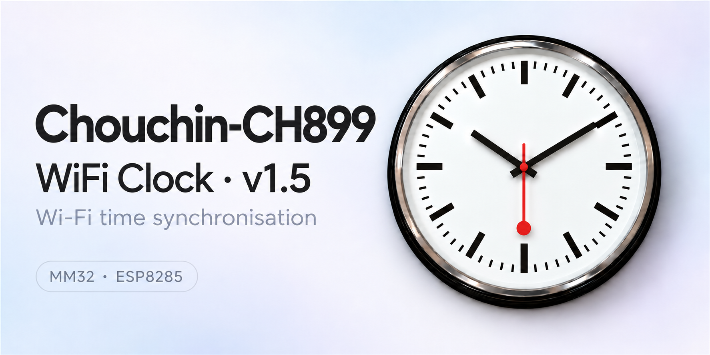
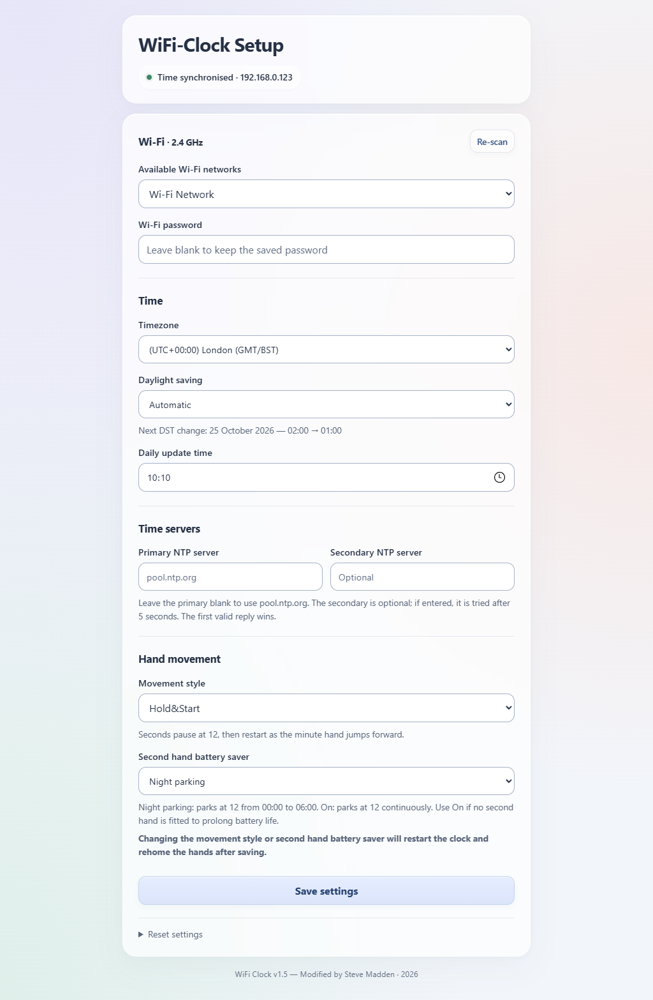

# CH899 · MM32 clock upgrade · v1.5

**For the older clock board with “MM32” printed on its main chip.** Choose this project to add movement styles and seconds-hand battery saving. It replaces the clock's movement and Wi-Fi software.

## Other clock projects

| Other repository | Choose it if… |
| --- | --- |
| [**MM32 — Wi-Fi only**](https://github.com/maddenste/Chouchin-CH899-Firmware) | You have the same MM32 board but want to keep the factory hand movement |
| [**HC32 — clock upgrade**](https://github.com/maddenste/Chouchin-899-latest-revision) | Your clock's main chip says HC32 |

## Check your board

Open the clock's movement cover and look for **MM32** on the large square chip, as shown below. [More board photos and identification help →](docs/HARDWARE.md)

Click the photo to enlarge it. If your board differs, check the identification guide before installing.

## What this upgrade adds

- **Three movement styles:** Sweep, Burst and the station-clock pause at 12.
- **Seconds-hand battery saving:** park it overnight or all day.
- **Phone-friendly settings:** Wi-Fi, timezone, automatic summer/winter time changes and your daily time-update schedule.

## Install

**[Start installation →](docs/GETTING_STARTED.md)**

Follow the guide in order. It covers the equipment, downloads, programming both chips and Wi-Fi setup. You need a Windows PC and programming equipment; no compiling is required.

> [!WARNING]
> **Install at your own risk.** The factory movement software cannot be backed up or recovered from the chip after replacement. Testing is ongoing; please [report any bugs](https://github.com/maddenste/Chouchin-CH899-MM32-ESP8285/issues).

**Already installed?** [Change settings](docs/USER_GUIDE.md) · [Get help](docs/TROUBLESHOOTING.md)

## Built from scratch

We started with an undocumented board: getting the hands to move, finding the LED and button connections, understanding the Wi-Fi messages and discovering the separate timekeeping chip. Those findings became replacement software for both chips, with much of the work devoted to smooth seconds-hand movement. [Read the background →](docs/BACKGROUND.md)

See the settings page

---

Unofficial project · Modified by Steve Madden · 2026.

[Downloads and release notes](https://github.com/maddenste/Chouchin-CH899-MM32-ESP8285/releases/tag/v1.5) · [Developer documentation](docs/development/README.md) · [License and credits](NOTICE.md) · [Third-party notices](THIRD_PARTY_NOTICES.md)
