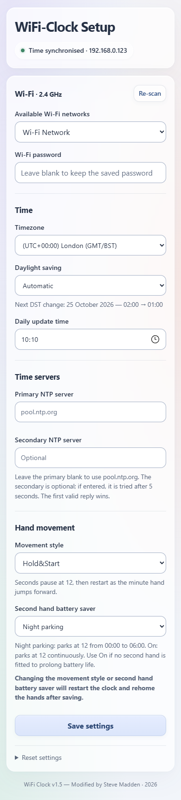

# Settings and everyday use

## Open the settings page

1. Hold **M.SET for about three seconds**.
2. Join the clock's **WiFi-Clock-Setup** network.
3. Open **http://192.168.4.1/** in your browser.

Alternatively, while the clock is awake, stay on your home network and open the clock's IP address shown in your router. It appears as **WiFi-Clock-** followed by six letters/numbers. There is no guaranteed `.local` address.

The setup network is available on every Wi-Fi wake, even after home Wi-Fi details have been saved. If your phone says the setup network has no Internet, stay connected while using the page.

## Wi-Fi

Select your **2.4 GHz** network and enter its password. Choose manual entry if you need to type the network name yourself.

When keeping the same network, leave the password blank to retain the saved password. The page does not display your stored password.

## Timezone and daily updates

Select the timezone for your location. Leave daylight saving on **Automatic** for normal use; choose **Disabled** if you do not want seasonal changes.

**Daily update time** is the local time when the clock connects to check the time. Choose any hour and minute. The clock also schedules an extra connection before a daylight-saving change; you do not need to move your daily update time for it.

### Time servers

The default primary server is **pool.ntp.org**. Most users can leave it unchanged. The secondary server is optional and is blank by default.

If you enter your own server, use its hostname or IPv4 address, without `http://`, a path or a port number.

Advanced: custom daylight-saving rules

Choose **Custom rule** only if you need a rule different from the preset. The field expects a POSIX rule, not a location name such as `Europe/London`.

For example, `GMT0BST,M3.5.0/1,M10.5.0/2` is an accepted rule format. Fixed offsets and rules beginning with `M` are supported; Julian/day-number forms are not. Check the dates and offsets for the location you intend to use. Press Save settings to apply a rule, or return to Automatic and save to use the selected timezone's preset.

## Movement style

Use the **Movement style** dropdown:

| Style | What you will see |
| --- | --- |
| Sweep | Seconds run continuously; the minute hand moves in small steps throughout the minute |
| Burst | Seconds run continuously; the minute hand advances in a short burst at the minute |
| Hold&Start | Seconds move slightly faster, pause at 12, then start again for the next minute as the minute hand advances |

With Hold&Start, the seconds hand runs ahead to create the pause. Its dial position between pauses will not always match the seconds on another clock. This is expected.

## Second hand battery saver

| Setting | What happens |
| --- | --- |
| Off | The seconds hand follows the selected movement style all day |
| Night parking | Seconds park at 12 from midnight until 06:00, then resume |
| On | Seconds stay parked at 12 all day; also useful if no seconds hand is fitted |

The minute and hour hands continue working in every setting. If you power on during the overnight period, the seconds hand may complete its first revolution before parking.

## Save your changes

Press **Save settings**. If the page reports a problem, follow its message and try again.

**Changing the movement style or second hand battery saver will restart the clock and rehome the hands after saving.** Allow several minutes for the hands to find their reference positions and return to the correct time.

Changing the timezone or receiving a time correction can also make the hands pause or move while they set themselves. Leave the clock to finish; a blue LED does not mean the hands have already reached the new time.

After saving or leaving the page, the clock can switch Wi-Fi off to save power. The webpage may then become unavailable. Hold M.SET again when you want to reopen it. If you changed the network, reconnect using that network's new clock address or use WiFi-Clock-Setup.

## Buttons

Hold the buttons for about **three seconds**:

| Button | Action |
| --- | --- |
| M.SET | Open a Wi-Fi/settings session; saved settings are kept |
| REC | Move to the hand-fitting reference and stop normal running until the clock is restarted |
| M.SET + REC together | Erase saved Wi-Fi and clock settings |

To fit or refit the hands, use REC and wait until the movement has stopped at its reference. Remove power before touching the hands or gears. Restore power afterwards to home and set the clock again.

To clear settings from the webpage instead, expand **Reset settings** and select **Erase settings**. You will need to enter your Wi-Fi details and preferences again.

## LEDs

| Indication | Meaning |
| --- | --- |
| Flashing red alone | The clock is requesting time or opening a session |
| Blue | Time has been received; the hands may still be setting |
| Red and blue flashing together in repeated groups | A numbered fault — count the flashes and use [the error-code guide](TROUBLESHOOTING.md#error-codes) |

For connection, hand-position or movement problems, see [troubleshooting](TROUBLESHOOTING.md).

Use the settings page on a trusted local network. Do not make it accessible from the Internet; see [security](../SECURITY.md).
